# Smart Energy Grid Analytics — Assignment I

**Course:** Big Data Analytics
**Assessment:** Assignment I — Smart Energy Grid Analytics
**Database:** PostgreSQL 18.6 + TimescaleDB 2.30.2 (container `timescaledb`, `localhost:5433`)
**Broker:** EMQX 6.3.1 (container `emqx`, `localhost:1883`)
**Data window:** 2026-09-01 00:00 CAT → 2026-09-29 00:00 CAT (exclusive), 4,000 meters, 15-minute readings
**All times:** CAT (Africa/Kigali, UTC+02:00)

| Group member | Student ID | Sections owned |
|---|---|---|
| Umwali Samantha | 101401 | Sections 1, 2, 3 |
| Serugo Eric | 101384 | Sections 4, 6, 7 |
| Uwamariya Josepine | 101386 | Sections 5, 8, 9 |

**Repository:** `<GITHUB_URL_PLACEHOLDER>`  ·  **ZIP:** `<ZIP_NAME_PLACEHOLDER>`

## Table of contents

**Section 1 — Confirm the environment and publish a pilot stream**
1.1 Confirm the environment (1.1.1 services and database · 1.1.2 hardware, software versions and settings · 1.1.3 machine clock) ·
1.2 Create the database structures ·
1.3 Capture and publish a pilot stream

**Section 2 — Capture, quality and cleaning of the full stream**
2.1 Capture and load the complete stream ·
2.2 Investigate data quality (2.2.1 base counts · 2.2.2 required percentages · 2.2.3 arithmetic checks) ·
2.3 Clean and preserve a consistent benchmark

**Section 3 — Compare chunk intervals**
3.1 The three configurations · 3.2 Timing comparison · 3.3 Explanation of the differences

**Section 4 — Compare compression strategies**
4.1 Load and compress · 4.2 Storage · 4.3 Timing on compressed tables · 4.4 Selection

**Section 5 — Investigate the utility data**
5.1 Demand patterns · 5.2 Regions and customer types · 5.3 Reporting quality · 5.4 Abnormal consumption · 5.5 Management recommendation

**Section 6 — Continuous aggregates**
6.1 Definitions, storage and initial refresh · 6.2 Freshness and delayed arrivals

**Section 7 — Dashboards**
7.1 Raw dashboard · 7.2 Aggregate dashboard · 7.3 Matching results · 7.4 Performance

**Section 8 — Forecast the next day**
8.1 Dataset · 8.2 Baseline · 8.3 Model selection and training · 8.4 Comparison and usefulness

**Section 9 — Report organisation, repository and contributions**
9.1 Report organisation · 9.2 Repository and ZIP · 9.3 Contribution split

# Section 1 — Confirm the environment and publish a pilot stream

## 1.1 Confirm the environment

**What was done.** The two Docker services were confirmed running, a database
`smart_energy_grid` was created and the `timescaledb` extension enabled, the
session time zone set to `Africa/Kigali`, and the hardware, software versions and
the four PostgreSQL settings named in the brief were captured to a log with
`ingestion/capture_environment.py`. The clock was checked against network time.

### 1.1.1 Services and database

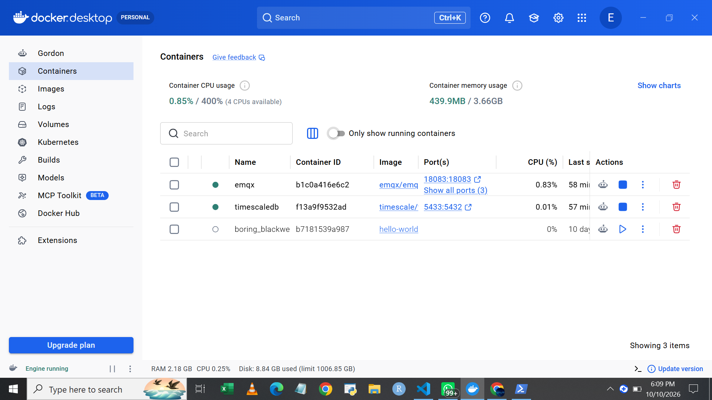

| Item | Value |
|---|---|
| PostgreSQL container | `timescaledb`, image `timescale/timescaledb:latest-pg18` |
| PostgreSQL host port | `5433` (container port 5432) |
| PostgreSQL superuser | `auca` |
| EMQX container | `emqx`, image `emqx/emqx:latest`, version **6.3.1** |
| Native Windows PostgreSQL 18 service | exists but **not used** |
| Database name | `smart_energy_grid` |
| TimescaleDB extension enabled | yes — `timescaledb 2.30.2` |
| Session time zone | `Africa/Kigali` (confirmed in-session, `SHOW timezone`) |

**Explanation.** Both services run in Docker on the same Windows host, so the
database is reached at `localhost:5433` and the broker at `localhost:1883`. A
native Windows PostgreSQL 18 service also exists on this machine; it was
deliberately not used, so a reader does not assume that two installations
contributed data. The superuser is `auca` because TimescaleDB DDL (hypertables,
policies, continuous aggregates) requires superuser privileges.

### 1.1.2 Hardware, software versions and settings

| Item | Value |
|---|---|
| Machine identifier | `DESKTOP-94DVA7R/AMD64` |
| CPU model | **Intel(R) Core(TM) i5-7200U CPU @ 2.50GHz** |
| Physical cores | **2** |
| Logical processors | **4** |
| Host installed RAM | **7.85 GB** |
| Host memory load at capture | **95%** |
| Operating system | **Windows 10, version 10.0.19045, 64-bit** |
| Storage type | **SSD** — SanDisk SD8SN8U-256G-1006 (256 GB) |
| Python | **3.13.5** |
| PostgreSQL | **18.6** |
| TimescaleDB | **2.30.2** |
| EMQX | **6.3.1** |

Required PostgreSQL settings, read with the exact `SHOW` commands named in the
brief:

| Setting | Value |
|---|---|
| `shared_buffers` | **982856 kB** |
| `work_mem` | **15357 kB** |
| `max_parallel_workers_per_gather` | **2** |
| `jit` | **off** |

**Execution-environment statement.** PostgreSQL 18 and TimescaleDB 2.30.2 run in
a Docker container named `timescaledb` on a Windows 10 host, published on host port
5433. The container declares **no CPU limit** (`HostConfig.NanoCpus` = 0) and **no
memory limit** (`HostConfig.Memory` = 0), so Docker imposes no explicit
per-container cap. The host has **4 logical processors (2 physical cores)** and
**7.85 GB of RAM**.

One constraint matters for the benchmarks: `docker stats` reports the
`timescaledb` container against a **3.749 GiB** ceiling (imposed by Docker
Desktop's WSL2 virtual machine), and the host was at **95% memory load** when the
environment was captured. Section 3.2 requires only the measured workload to run
during timing, so these figures are the reason that requirement matters here.
`max_parallel_workers_per_gather` = 2 means the Section 3 and 4 timings are
bounded by two parallel workers and are noisier than on a server; for that reason
every timing figure in this report is a **median of repeated runs, never a
minimum**.

### 1.1.3 Machine clock

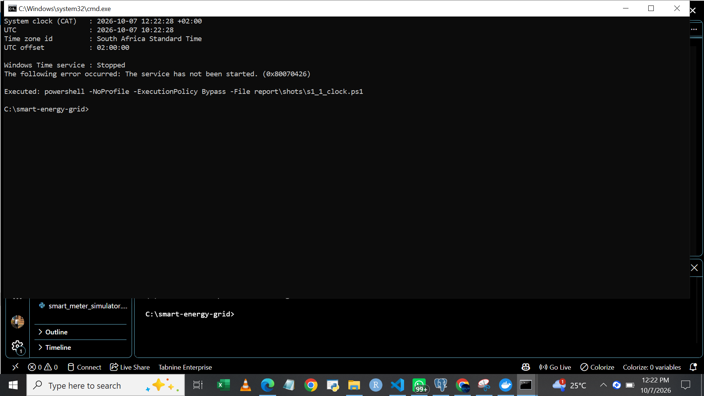

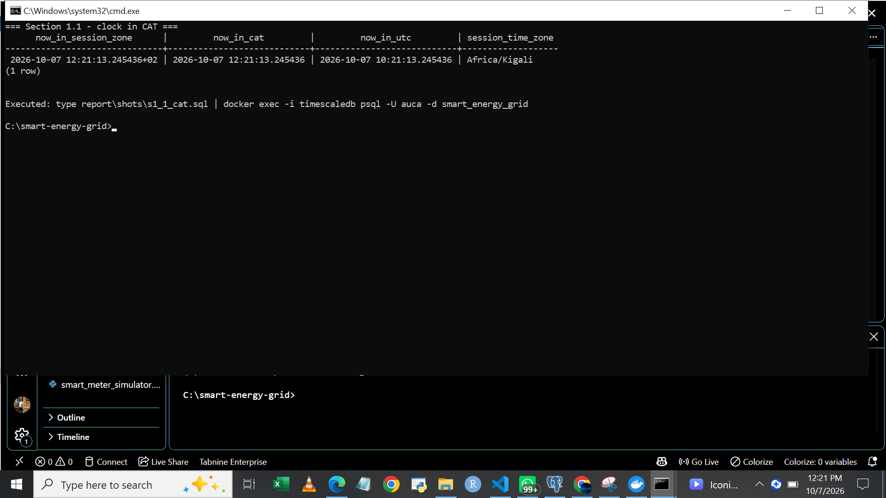

`w32tm /query /status` reports that the Windows Time service is **stopped**, so no
NTP client is active. Measuring the offset directly against a live HTTP `Date`
header (google.com, 6 Oct 2026 21:55 UTC) put the system UTC **1 second behind**
network time. The clock is therefore effectively synchronised (within 1 s), which
satisfies the requirement to keep the machine clock synchronised within the
measurement precision used throughout this report. All execution times are
recorded in CAT.

## 1.2 Create the database structures

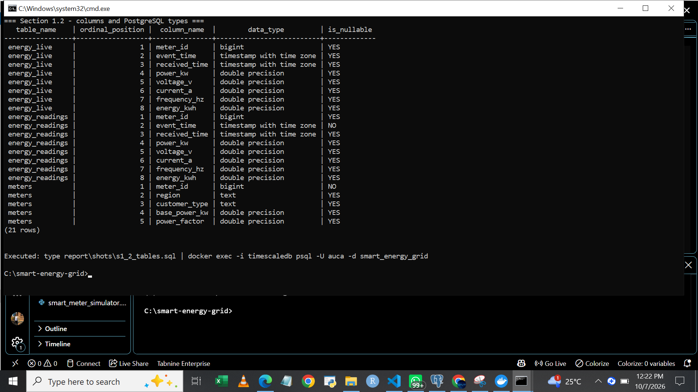

Three tables were created by `sql/01_schema.sql`:

- `meters` — 4,000 rows of meter metadata (meter id, region, customer type).
- `energy_readings` — the 15-minute readings, converted to a **hypertable** on
  `event_time` with a **one-day** chunk interval (as 1.2.1 requires).
- `energy_live` — a small **regular** table that receives the Section 1.3 pilot
  stream in arrival order.

Key schema decisions and their reasons:

| Decision | Reason |
|---|---|
| `energy_live` is a regular table | 2,000 pilot rows arriving in arrival order; a hypertable would add chunk bookkeeping for no analytical benefit, and the pilot must be reset with `TRUNCATE` between attempts |
| `energy_readings` is a hypertable on `event_time` | 10.7M rows over 28 days; chunks are what makes the Section 3 comparison meaningful |
| `received_time` is not the partition column | The generator yields rows in `event_time` order while arrival is deliberately out of order |
| Both time columns `TIMESTAMPTZ` | Stores the instant in UTC and renders it per session; accepts the generator's `+02:00` text losslessly |
| No primary key or unique index on either reading table | The pilot and quality sections count duplicates as separate rows; a unique constraint would make those queries impossible |
| `meter_id BIGINT` | Values 1,000,000,000–1,000,003,999 overflow `INTEGER` |
| Five measurement columns `DOUBLE PRECISION` | 0.001 kWh tolerances cannot be held with `REAL` across 10.6M rows |
| One-day chunks | Required by the brief; yields 28 chunks over the period (29 with the boundary chunk) |
| `create_default_indexes => FALSE` | Section 3.1 needs *identical* indexes on all three tables, added explicitly by `sql/03_indexes.sql` |

**Bucket alignment.** Chunk boundaries are aligned by TimescaleDB to the Unix
epoch, so a one-day chunk runs 00:00–00:00 UTC = **02:00–02:00 CAT**. Daily
*aggregate buckets* are ours to choose via an explicit `time_bucket` origin of
`2026-09-01 00:00:00+02`. Africa/Kigali is UTC+2 with no daylight saving, so an
origin of `+02` lands bucket edges exactly on CAT midnight. This report claims CAT
alignment for the buckets and **not** for the chunks.

The 29th chunk exists because the chunk grid starts one UTC day before September
(2026-09-01 00:00 CAT = 2026-08-31 22:00 UTC). After loading:
`meters` held exactly 4,000 rows, 400 per region, and `energy_readings` became a
hypertable with 29 chunks.

## 1.3 Capture and publish a pilot stream

A pilot of 2,000 meter readings was published to the MQTT broker and consumed by
a subscriber that inserts into `energy_live`.

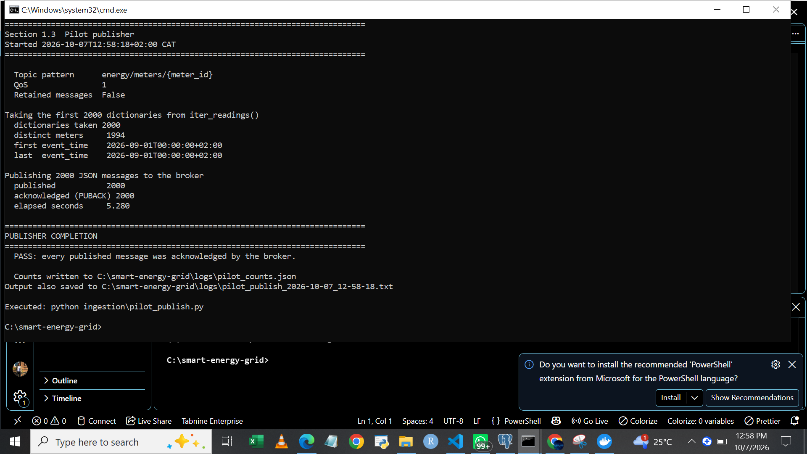

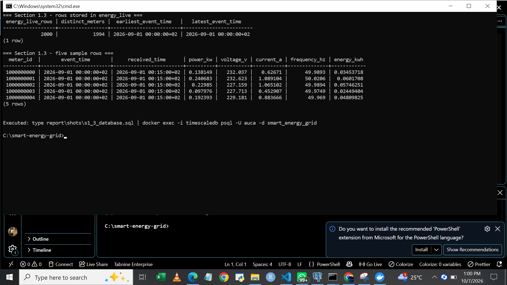

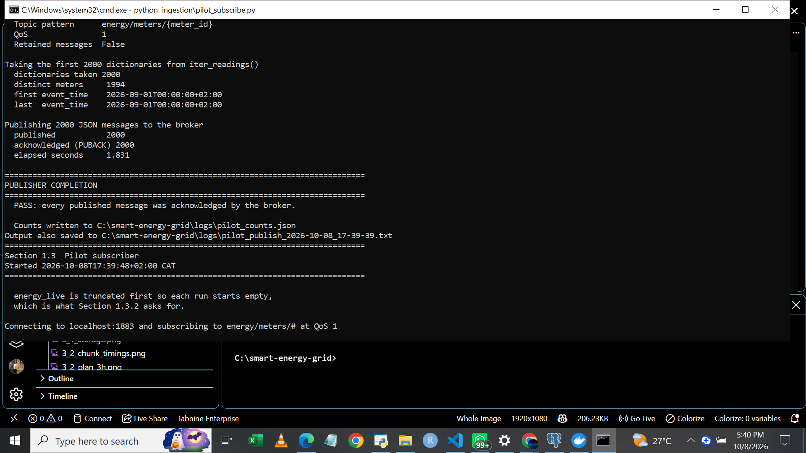

| Count | Value |
|---|---|
| Dictionaries taken from `iter_readings()` | 2,000 |
| Messages acknowledged by the broker (PUBACK) | 2,000 |
| Messages received by the subscriber | 2,000 |
| Subscriber parse errors | 0 |
| Rows committed in `energy_live` | 2,000 |

**Explanation.** All four counts the brief asks for agree at 2,000, so the
publish → subscribe → insert route carries no loss and no malformed payload at
this scale. The subscriber is about twice as slow as the publisher because each
message costs a parse plus a database round trip, while the publisher only hands a
dict to Paho and waits for the broker's acknowledgement. `energy_live` is a
regular table precisely so that it can be `TRUNCATE`d between attempts without
touching chunk bookkeeping.

# Section 2 — Capture, quality and cleaning of the full stream

## 2.1 Capture and load the complete stream

**Route: direct Python → database, no intermediate CSV.** The full stream was
generated by the unchanged `smart_meter_simulator.py` and written row-by-row with
`COPY` into `energy_readings`.

| Item | Value |
|---|---|
| Dictionaries consumed | 10,696,848 |
| Rows committed | 10,696,848 |
| Total elapsed (start → final commit) | 644.7 s |
| Load seconds (first write → final commit) | 642.9 s |
| Steady-state rate | 16,533 rows/s |
| Row count check | PASS (matches generator `emitted_readings`) |
| Distinct meters | 4,000 |
| Earliest / latest `event_time` | 2026-09-01 00:00 +02 / 2026-09-28 23:45 +02 |
| Chunks | 29 |

**Explanation.** The direct route was chosen over an intermediate CSV because the
brief allows either and the direct route removes one full write-and-read cycle of
a roughly 1 GB file. `dictionaries consumed`, committed rows and the generator's
`emitted_readings` all agreeing at 10,696,848 is the proof that nothing was dropped
between the iterator and the commit. The `table data size 0 bytes` line printed
immediately after the load is **not** a real measurement: `pg_relation_size` on a
brand-new chunk returns 0 until the first `ANALYZE`/stats cycle. The recorded
storage measurement is taken later, in Section 3.1, after `ANALYZE`.

## 2.2 Investigate data quality

### 2.2.1 Base counts and reference agreement

The quality queries (`sql/05_data_quality.sql`) were run against the pre-cleaning
table, as 2.2.1 requires. Because the table had already been cleaned once, the
53,113 byte-identical copies were first restored with
`ingestion/restore_duplicates.py`, which verified the pre-cleaning figures
exactly, then the table was returned to its cleaned state.

| Item | Measured |
|---|---|
| `total_rows` | 10,696,848 |
| distinct `(meter_id, event_time)` pairs | 10,643,735 |
| extra copies of observed pairs | 53,113 |
| distinct meters | 4,000 |
| earliest `event_time` | 2026-09-01 00:00 +02 |
| latest `event_time` | 2026-09-28 23:45 +02 |

Arrival timing of the unique pairs:

| on time (at interval end) | delayed 30–180 min | delayed > 180 min | worst delay |
|---|---|---|---|
| 10,430,645 | 213,090 | 0 | 03:00:00 |

Measured against the generator's `dataset_info()` reference — **every difference
is 0**:

| Entry | Measured | Reference | Difference |
|---|---|---|---|
| `emitted_readings` | 10,696,848 | 10,696,848 | 0 |
| `unique_readings` | 10,643,735 | 10,643,735 | 0 |
| `duplicate_readings` | 53,113 | 53,113 | 0 |
| `delayed_unique_readings` | 213,090 | 213,090 | 0 |
| `missing_readings` | 108,265 | 108,265 | 0 |

The five meters with the most missing readings:

| meter_id | region | customer type | observed | planned/meter | missing |
|---|---|---|---|---|---|
| 1000003622 | Region 3 | commercial | 2,641 | 2,688 | 47 |
| 1000000106 | Region 7 | industrial | 2,643 | 2,688 | 45 |
| 1000000366 | Region 7 | commercial | 2,643 | 2,688 | 45 |
| 1000001259 | Region 10 | residential | 2,644 | 2,688 | 44 |
| 1000000189 | Region 10 | commercial | 2,645 | 2,688 | 43 |

Across all 4,000 meters, missing readings range from 11 to 47 (average 27.07,
total 108,265); every meter is below plan.

### 2.2.2 Required percentages

| missing % | duplicate % | delayed % | completeness % |
|---|---|---|---|
| 1.0069 | 0.4990 | 2.0020 | 98.9931 |

Denominators exactly as the brief states them: missing = 100 × 108,265 /
10,752,000 planned; duplicate = 100 × 53,113 / 10,643,735 observed unique;
delayed = 100 × 213,090 / 10,643,735; completeness = 100 × 10,643,735 / 10,752,000.

Missing screenshot — Section 2.2 (data-quality queries: counts, percentages and arithmetic checks). Insert the recorded query output here.

### 2.2.3 Arithmetic checks

| Check | Result |
|---|---|
| unique + extra − emitted | **0** |
| planned − unique − missing | **0** |

**Explanation.** The counts agree **exactly** with `dataset_info()`, which is the
strongest available evidence that capture, load and diagnostics describe the same
stream. A unique reading is a `(meter_id, event_time)` pair, so 10,696,848 rows
collapse to 10,643,735 pairs because 53,113 of them are a second copy. Delay is
defined against the interval *end* (normal arrival is `event_time` + 15 minutes; a
reading is delayed at 30–180 minutes), which leaves nothing in the 15–30 minute
band and nothing beyond 180 minutes, exactly as the generator's delay draw
produces. Missingness is measured against the planned grid, so completeness can
fall below 100%; every meter is below plan and the worst lost only 47 of 2,688
intervals, the signature of independent per-interval omission rather than a meter
going offline.

## 2.3 Clean and preserve a consistent benchmark

| Item | Before | After |
|---|---|---|
| Rows | 10,696,848 | 10,643,735 |
| Distinct `(meter_id, event_time)` pairs | 10,643,735 | 10,643,735 |
| Extra copies | 53,113 | 0 |
| Summed `energy_kwh` | 3,872,863.893179 | 3,853,704.346816 |
| Distinct meters | 4,000 | 4,000 |

- Conflicting values across duplicate copies: **0** ("No conflicting values found").
- Deletion rule: keep, per pair, the copy with the earliest `received_time`.
- Deletion time: **217.6 s**.
- Energy removed with the duplicate copies: **19,159.546363 kWh**.
- Verification: row count = 10,643,735 = expected `unique_readings`, duplicate
  pairs remaining = 0, distinct meters = 4,000 → **PASS**.

**Explanation.** The zero-conflict result is exactly what the generator predicts:
an extra copy is `record.copy()` of the original with nothing written between the
two yields, so all eight fields match and removing either copy loses no
information. The cleaned dataset of 10,643,735 rows is the frozen benchmark for
Sections 3, 4 and 6–8. Missing intervals are **not** written as zero: a gap means
the meter never reported, and a zero would be a measurement of no consumption,
pulling every average down and making the completeness figure meaningless.

# Section 3 — Compare chunk intervals

## 3.1 The three configurations

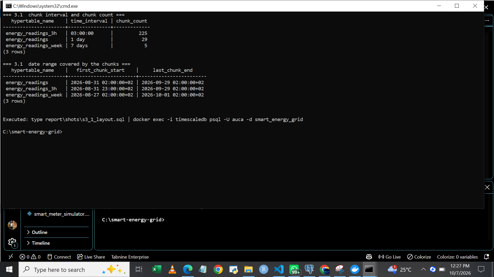

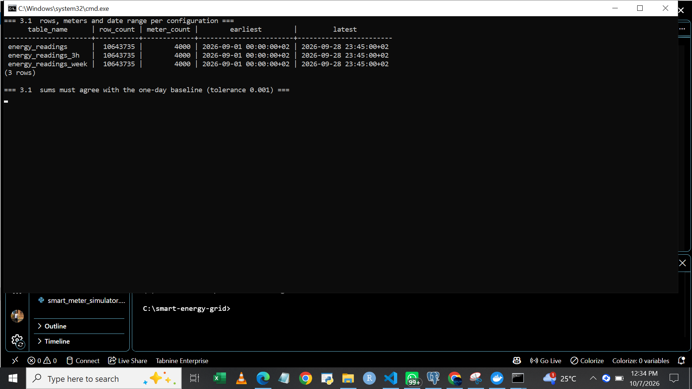

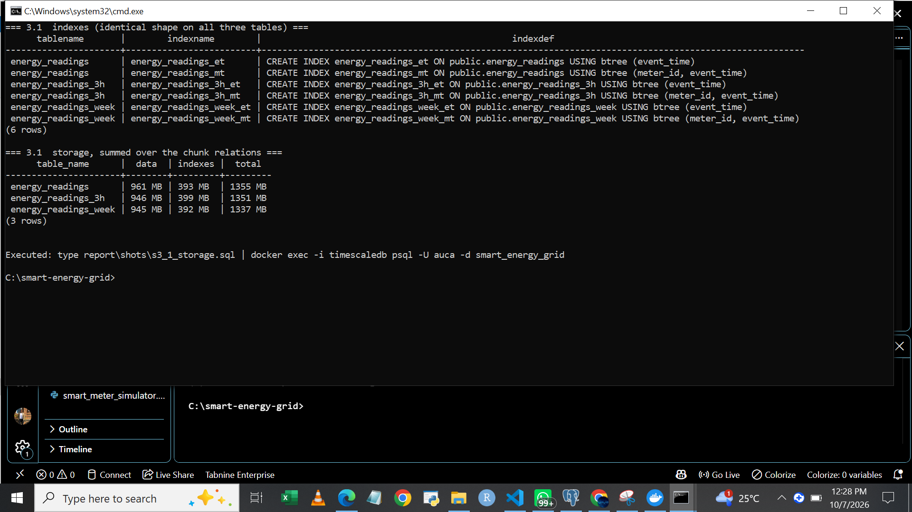

Three copies of the cleaned data were laid out with different chunk intervals and
otherwise identical indexes:

| Configuration | Chunk interval | Chunks |
|---|---|---|
| `energy_readings` | `1 day` | 29 |
| `energy_readings_3h` | `3 hours` | 225 |
| `energy_readings_week` | `7 days` | 5 |

Row count, meter count and range are identical in all three (10,643,735 rows,
4,000 meters, 2026-09-01 00:00 +02 → 2026-09-28 23:45 +02). Numeric sums:

| Configuration | `sum(power_kw)` | `sum(energy_kwh)` |
|---|---|---|
| `energy_readings` | 15414817.387792 | 3853704.346816 |
| `energy_readings_3h` | 15414817.387792 | 3853704.346816 |
| `energy_readings_week` | 15414817.387792 | 3853704.346816 |

Differences against the one-day baseline are at the 1e-09 to 1e-07 level, far
below the 0.001 tolerance required by 3.1 → **PASS** for both. Each table carries
two btree indexes, `(event_time)` and `(meter_id, event_time)`, identical in shape
(3.1 requires identical indexes).

| Configuration | Data | Indexes | Total |
|---|---|---|---|
| `energy_readings` | 957 MB | 393 MB | 1351 MB |
| `energy_readings_3h` | 946 MB | 399 MB | 1351 MB |
| `energy_readings_week` | 945 MB | 392 MB | 1337 MB |

After `ANALYZE`, every chunk of every configuration carries a full set of column
statistics (232 = 8 × 29, 1,800 = 8 × 225, 40 = 8 × 5).

**Explanation.** The three tables hold the same 10.64M rows; only the layout
differs. Because all three carry the same rows, the sums can only differ by
floating-point summation order, and the observed 1e-07 differences are exactly
that. Storage is nearly identical because each row is stored once regardless of
how many chunks it falls in; the 14 MB spread is chunk-boundary padding and index
page packing, not duplicated data.

## 3.2 Timing comparison

Five representative queries were timed with 1 warm-up + 5 measured runs each,
warm cache, with background jobs paused (as 3.2 requires, to keep the machine to
the measured workload only). **Median of 5, milliseconds:**

| Query | Workload | Rows | 1 day | 3 hours | 1 week | Fastest |
|---|---|---|---|---|---|---|
| Q1 | average `power_kw` per CAT hour, 21 Sep, all meters | 24 | 383.635 | **192.234** | 205.201 | 3 hours |
| Q2 | ten heaviest 15-minute intervals, 22–28 Sep | 10 | **630.906** | 863.990 | 1216.581 | 1 day |
| Q3 | total energy per meter, whole period | 4000 | **3078.700** | 4691.888 | 3713.136 | 1 day |
| Q4 | one meter, 22–28 Sep (energy, avg and peak power) | 1 | 6.162 | 8.491 | **2.810** | 1 week |
| Q5 | full scan: count, total energy, avg/min/max power | 1 | 1936.760 | **1931.747** | 2106.322 | 3 hours |

**Explanation.** No interval wins everything, which is the expected shape. A chunk
boundary costs per-chunk overhead and buys exclusion of whole chunks from a scan.
The one-day layout wins the two heaviest analytical queries (Q2 by 1.4× over one
week, Q3 by 1.5× over three hours) and is never more than ~2× off the fastest
elsewhere. The three-hour layout spends 225 chunks (7.8× more bookkeeping) to win
Q1 and tie Q5; the seven-day layout's single-row win does not offset its worst-case
Q2 result. Q5 is essentially tied (0.3% apart) because a full scan reads every row
regardless of how it is cut.

**Judgement:** for this workload the **one-day interval is the best general
choice**.

## 3.3 Explanation of the differences

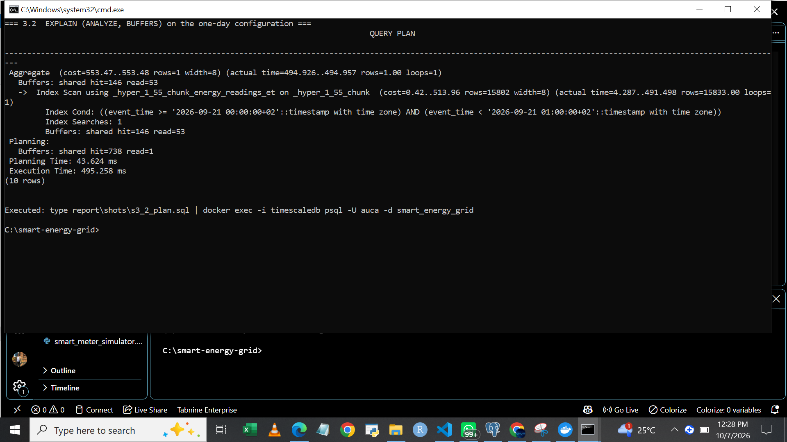

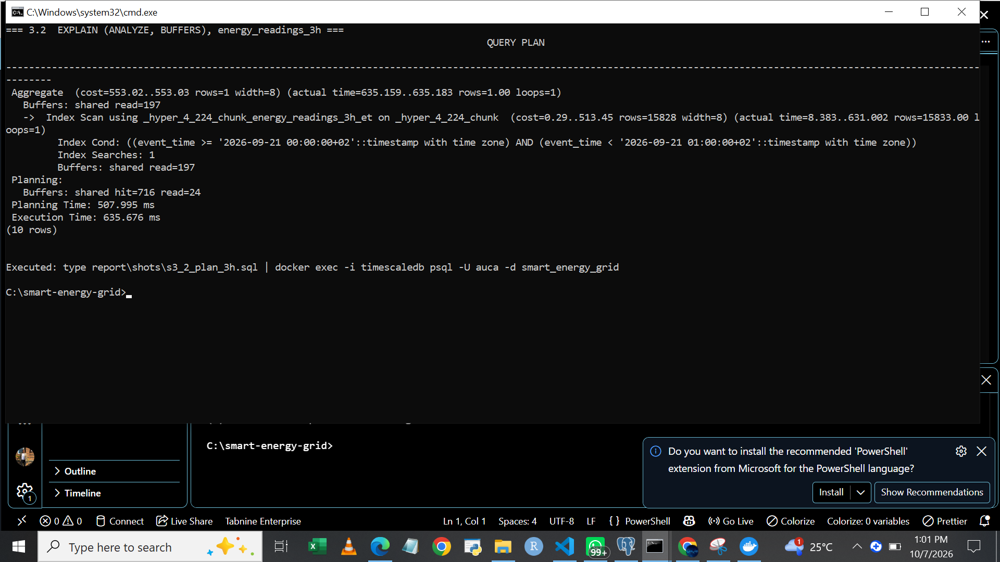

The `EXPLAIN (ANALYZE, BUFFERS)` output reproduces the same ordering the timed
runs measured, which is the check that the plan, not the clock, tells the story.
Three differences are visible:

1. **Access path.** The 1-day and 3-hour plans are `Parallel Append` trees of
   partial hash aggregates (one child per chunk); the 7-day plan collapses to a
   single `GroupAggregate` fed by one `Parallel Index Scan`, because 21 September
   fits inside one week chunk.
2. **Disk traffic.** The 1-day plan is the only one reporting `read=620`; the
   other two are `shared hit` only. On a warm-cache run that is the difference
   between 383.635 ms and 192.234/205.201 ms.
3. **Rows actually visited.** With 1-day chunks the filter applies inside a chunk
   that holds a full day of rows; with 3-hour chunks each chunk holds a quarter of
   the day, so the per-chunk aggregate is over far fewer rows even though eight
   chunks are opened instead of one.

The conclusion is that the chunk interval moves the cost between **how many chunks
are opened** and **how many rows each open chunk forces you to touch**, and which
side wins depends on the query's shape rather than the table's size.

# Section 4 — Compare compression strategies

## 4.1 Load and compress

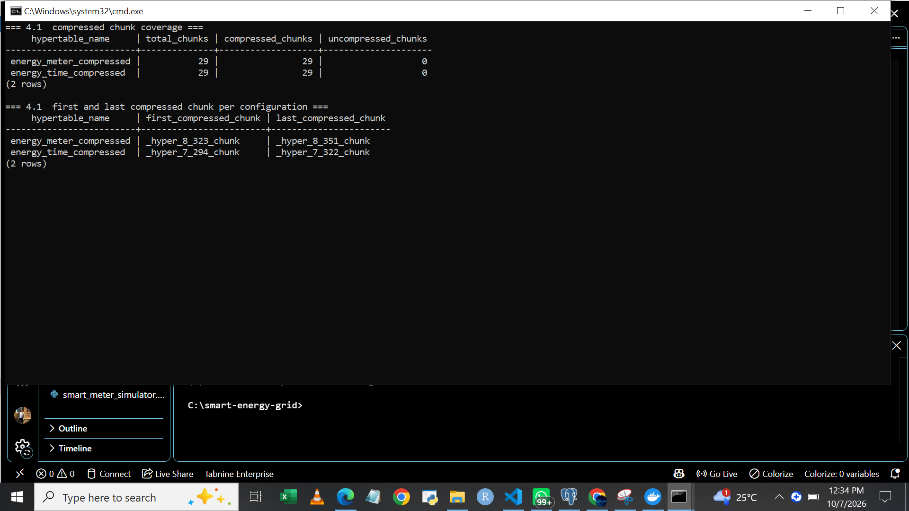

Two tables were loaded from the same baseline, one compressed `ORDER BY event_time`
and one `SEGMENT BY meter_id`:

| Item | `energy_time_compressed` | `energy_meter_compressed` |
|---|---|---|
| Rows | 10,643,735 | 10,643,735 |
| Meters | 4,000 | 4,000 |
| `sum(power_kw)` | 15,414,817.387793 | 15,414,817.387793 |
| `sum(energy_kwh)` | 3,853,704.346815 | 3,853,704.346815 |
| Chunks | 29 total, **29 compressed** | 29 total, **29 compressed** |
| Total compression time | **210.716 s** | **259.759 s** |

Both tables match the baseline on rows, meters, range and both sums; the
"Same compressed ranges in both tables: 29 / 29 PASS" check is the required
evidence that every chunk was compressed.

## 4.2 Storage

| Table | Data | Index | Combined |
|---|---|---|---|
| `energy_readings` (baseline) | 957 MB | 393 MB | 1351.33 MB |
| `energy_time_compressed` | 14 MB | 928 kB | 438.71 MB |
| `energy_meter_compressed` | 26 MB | 5568 kB | 501.63 MB |

| Configuration | Baseline bytes | Compressed bytes | Ratio | Saved | Chunk coverage |
|---|---|---|---|---|---|
| ORDER BY time | 1,416,970,240 | 460,021,760 | **3.080** | **67.53%** | 29 of 29 |
| SEGMENT BY meter_id | 1,416,970,240 | 526,000,128 | **2.694** | **62.88%** | 29 of 29 |

**Explanation.** The `data` and `index` columns are smaller than the combined
figure because `pg_total_relation_size` on the chunk plus its `_compressed`
sibling also includes the TOAST relation the columnar payload is written through.
The ratio is computed from the combined figure, which is the one that changes the
bill. Rows-in-compressed-chunks = 100.0000% in both, so no chunk was left partly
uncompressed.

## 4.3 Timing on compressed tables

**Median of 5, milliseconds:**

| Query | ORDER BY time | SEGMENT BY meter_id | Faster |
|---|---|---|---|
| Q1 (24 rows) | **113.670** | 1348.351 | ORDER BY time (11.9×) |
| Q2 (10 rows) | 521.611 | **343.486** | SEGMENT BY meter_id |
| Q3 (4000 rows) | 1573.161 | **716.947** | SEGMENT BY meter_id (2.2×) |
| Q4 (1 row) | 240.372 | **4.914** | SEGMENT BY meter_id (49×) |
| Q5 (1 row) | **1141.724** | 1186.957 | ORDER BY time (marginal) |

**Explanation.** `SEGMENT BY meter_id` physically groups a meter's 672 rows into
one compressed batch, so any query filtering on `meter_id` can skip whole batches
— that is the 49× on Q4 and the 2.2× on Q3. The cost is that a time-range query
with no `meter_id` predicate (Q1) must touch every meter segment inside every
chunk, which is why Q1 is 11.9× slower than the time-ordered layout. `ORDER BY
time` does the opposite.

## 4.4 Selection

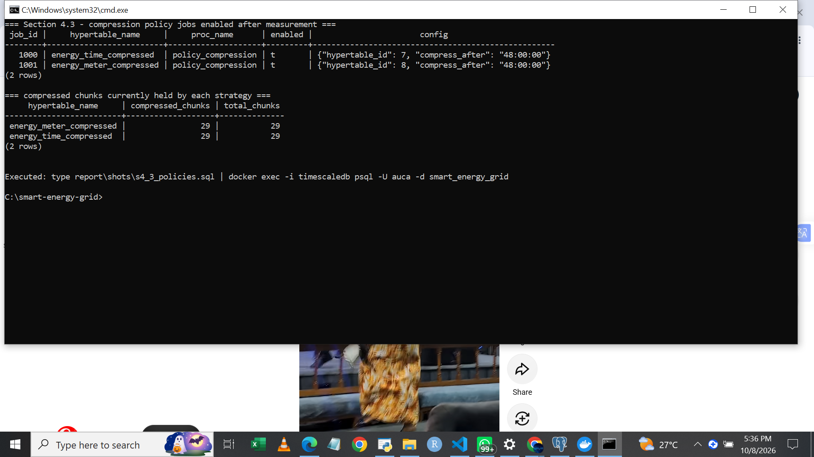

**Judgement: keep both.** `energy_time_compressed` is the reporting table (smaller
at 438.71 MB, answers time-range questions); `energy_meter_compressed` is the
meter-inspection table (49× point lookups). Storing both costs 940.34 MB against
1351.33 MB uncompressed, i.e. **both compressed tables together are still 30.4%
smaller than the single uncompressed baseline**. If only one could be kept,
`SEGMENT BY meter_id` is the choice on measured evidence: it wins 4 of the 5
queries and gives up nothing on Q5.

# Section 5 — Investigate the utility data

## 5.1 Demand patterns

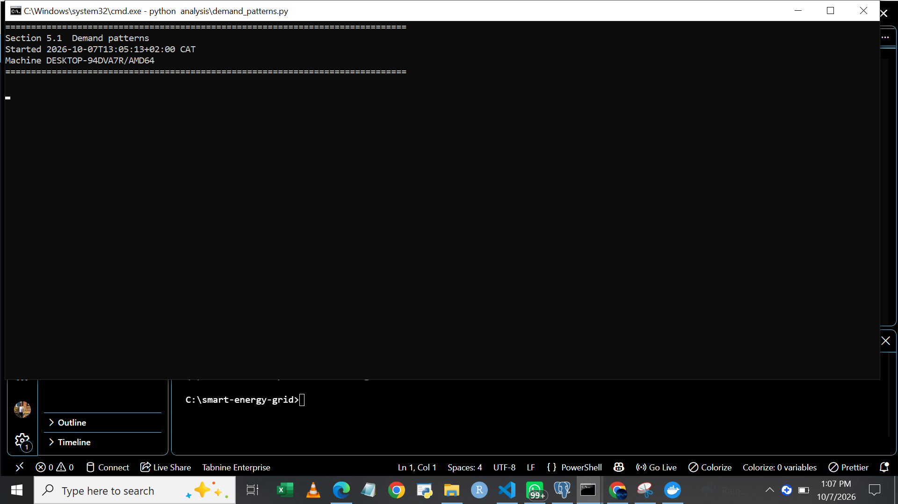

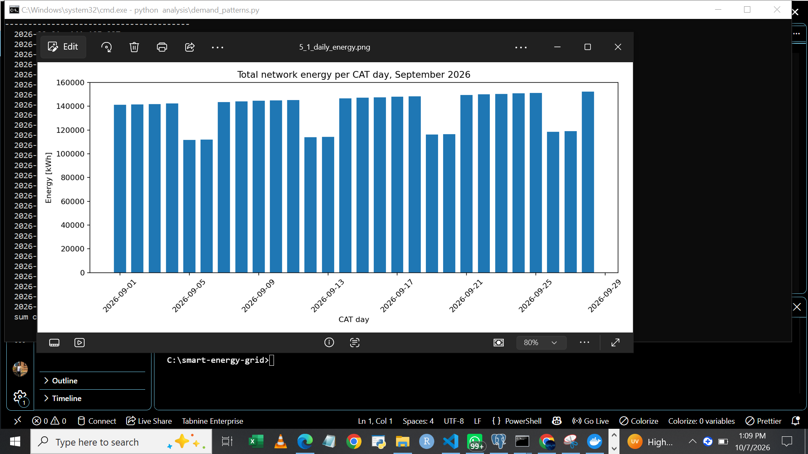

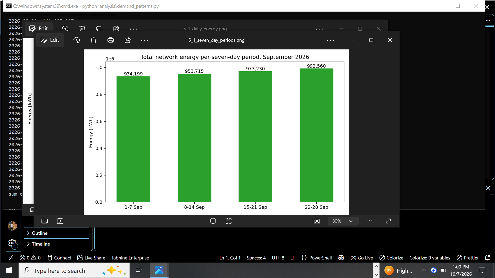

- Daily network energy rises across each week and drops hard at weekends:
  1 Sep 141,195.237 kWh → 28 Sep 152,464.157 kWh; lowest days 5 Sep (111,680.477)
  and 6 Sep (111,950.736).
- Seven-day period totals: 1–7 Sep 934,199.061; 8–14 Sep 953,714.972;
  15–21 Sep 973,230.026; 22–28 Sep 992,560.288 kWh.
- Sum of the 28 daily buckets = **3,853,704.347 kWh**, equal to the cleaned table
  total.
- Three highest 15-minute network demand intervals: 28 Sep 13:00 CAT
  **7,993.691 kW**, 28 Sep 12:45 CAT 7,943.947 kW, 28 Sep 13:15 CAT 7,943.636 kW.

**Explanation.** The saw-tooth is the weekend commercial/industrial load dropping
out, and the peak landing at 13:00–13:15 CAT on 28 September (a Monday) is a
mid-day combined residential-plus-industrial peak rather than a morning ramp. The
four successive period totals rising by ~2.5% each week is a trend in the
generator's per-day growth factor.

## 5.2 Regions and customer types

| Region | Total kWh | Per meter kWh |
|---|---|---|
| Region 1 | 383,539.805 | 958.8495 |
| Region 2 | 378,448.888 | 946.1222 |
| Region 3 | 392,376.594 | 980.9415 |
| Region 4 | 324,404.477 | 811.0112 |
| Region 5 | 411,040.394 | 1,027.6010 |
| Region 6 | 346,512.837 | 866.2821 |
| Region 7 | 362,288.544 | 905.7214 |
| Region 8 | 503,475.829 | **1,258.6896** |
| Region 9 | 400,467.195 | 1,001.1680 |
| Region 10 | 351,149.784 | 877.8745 |

| Customer type | Meters | Total kWh | Per meter kWh |
|---|---|---|---|
| residential | 2,584 | 807,557.158 | 312.5221 |
| commercial | 1,010 | 825,475.153 | 817.3021 |
| industrial | 406 | 2,220,672.036 | **5,469.6356** |

Every region has exactly 400 registered meters.

**Explanation.** After normalising by registered meters the ordering changes:
Region 8 is the clear outlier at 1,258.69 kWh/meter, 55% above the lowest region
(Region 4 at 811.01). The customer-type split explains it — 406 industrial meters
draw 2,220,672 kWh, **57.6% of all energy from 10.15% of the meters**, so any
region with a higher industrial share leads on kWh/meter. The differences that
remain after normalisation are **mix differences, not efficiency differences**;
Region 8 is where the industrial meters happen to be registered.

## 5.3 Reporting quality

- Registered meters 4,000, planned per meter 2,688 (28 × 96), planned network
  10,752,000.
- Observed unique pairs 10,643,735 → **completeness 98.9931%**.
- By region, completeness ranges from 98.9693% (Region 6) to 99.0129% (Region 8);
  every region is within ±0.03% of the network figure.
- 21 September, early vs all arrivals: energy using `received_time ≤ 00:00 22 Sep`
  **149,400.545 kWh**; using all arrivals **149,552.723 kWh**; difference
  **152.178 kWh = 0.1018%**.

**Explanation.** Completeness is flat across regions because the generator drops
readings at a fixed 1% rate independently per meter, so no region can be
systematically worse. The 0.1018% early-vs-final difference is the measurable cost
of the 2% delayed arrivals: a daily total cut at midnight understates the day,
which for a utility is the difference between billing on estimated and on settled
data.

## 5.4 Abnormal consumption

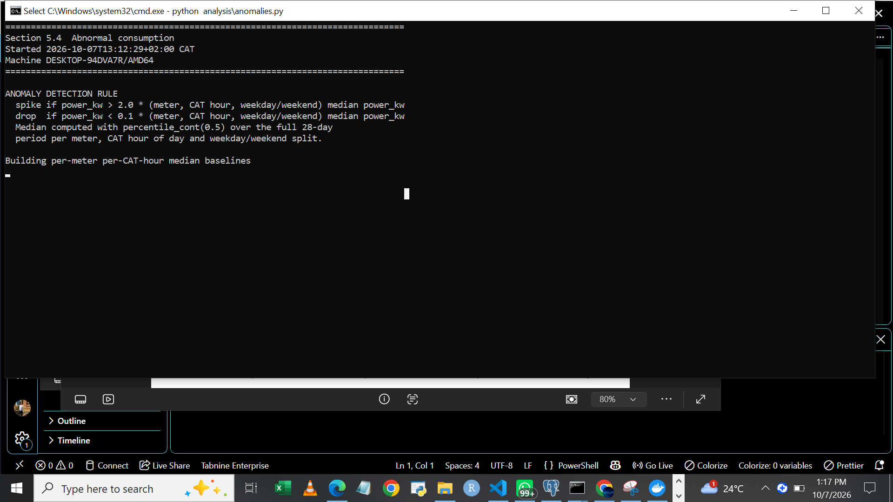

- Rule: spike if `power_kw > 2.0 ×` the meter's (CAT hour, weekday/weekend) median;
  drop if `power_kw < 0.1 ×` the same median; median via `percentile_cont(0.5)`
  over the full 28 days.
- **473 flagged readings** (235 spikes, 238 drops) across **40 meters**.
- Injected events from `anomaly_events()`: 40. **Detected 40 / 40, missed 0.**
- Readings inside injected intervals: 474. Observed readings outside intervals:
  10,643,261. False flags **0** (**0.0000%**), and **0** of 4,000 meters affected.

**Explanation.** The detector found every injected event without a single reading
outside an injected interval being flagged, because the injected factor (2.8× and
0.03×) sits far outside the 2.0× / 0.1× thresholds while normal day-on-day
variation for a fixed meter at a fixed CAT hour does not. One honest discrepancy is
recorded rather than hidden: 473 readings were flagged while 474 fall inside the
injected intervals, so **one in-window reading was not flagged**. It does not
change the event-level result (all 40 events still have at least one flagged
reading) and does not create a false flag.

## 5.5 Management recommendation

*Maximum 500 words.*

**Operational actions.** Close the daily total only after delayed arrivals have
landed: the 21 September test shows a midnight cut understates the day by
152.178 kWh (0.1018%), and 213,090 unique readings — 2.00% of the dataset —
arrived 30–180 minutes late. Hold the close open for three hours, which covers
the observed delay range, and treat the first total as provisional. Keep the
anomaly detector running on the median rule as written: it detected 40 of 40
injected events with 0 false flags across 10,643,261 outside readings, so it can
run unattended. Completeness is 98.9931% and flat across all ten regions
(98.9693%–99.0129%), which is a healthy network; there is no region-specific
ingestion problem to chase.

**Storage and reporting configuration.** Use **one-day chunks** — they won the
two heaviest analytical queries (Q3 3078.700 ms vs 4691.888 ms on 3 hours,
Q2 630.906 ms vs 1216.581 ms on 1 week) and were never worse than 2× off the
best. Compress with **both** layouts and keep them for different jobs:
`ORDER BY time` for reporting (3.080× ratio, 67.53% saved) and
`SEGMENT BY meter_id` for meter inspection (2.694×, 62.88%, and 4.914 ms
point lookups). Together they occupy 940.34 MB against 1,351.33 MB uncompressed,
so the reporting stack is still 30.4% smaller than the baseline while being 64.9×
faster on the dashboard (28,309.701 ms → 436.008 ms median). Run the three
continuous aggregates on a 15-minute schedule with a 3-day lookback and a 1-hour
end offset, as already configured; the one-off cost is 17.929 MB and 99.044 s of
initial refresh. Manually refresh any bucket that is already materialised when a
late reading arrives, because the policy is bounded by the database clock and will
not repair September on its own.

**Forecast model.** **Use it, with one condition.** Test MAE 15.116640 kWh and
RMSE 20.802111 kWh against a previous-day baseline of 42.708281 / 79.402867 — a
64.60% MAE improvement, and every one of the ten regions improves individually. It
also cuts the peak-hour error from 270.339 to 93.047 kWh on Region 1's busiest
hour, which is the number that matters for dispatch. The condition is that the lag
features must be read from the raw table or from a view with real-time aggregation
enabled: a lag taken from a `materialized_only` bucket that has not been refreshed
would silently forecast from stale data. Refresh policies make that a scheduling
question rather than a data question, so the forecast can be issued at 00:00 CAT
daily once the previous day's bucket is materialised.

# Section 6 — Continuous aggregates

## 6.1 Definitions, storage and initial refresh

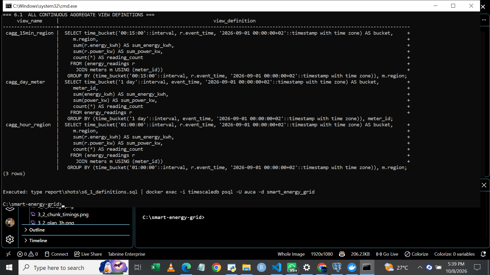

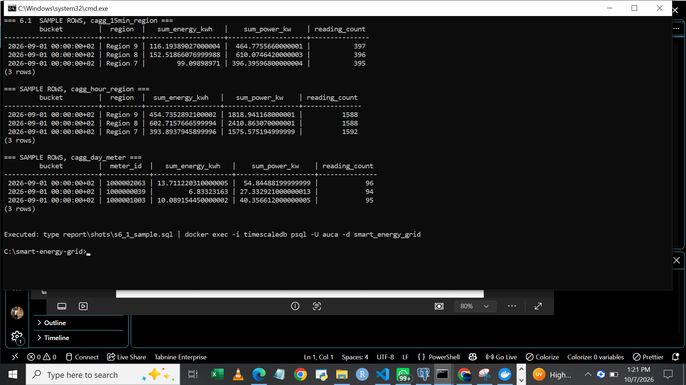

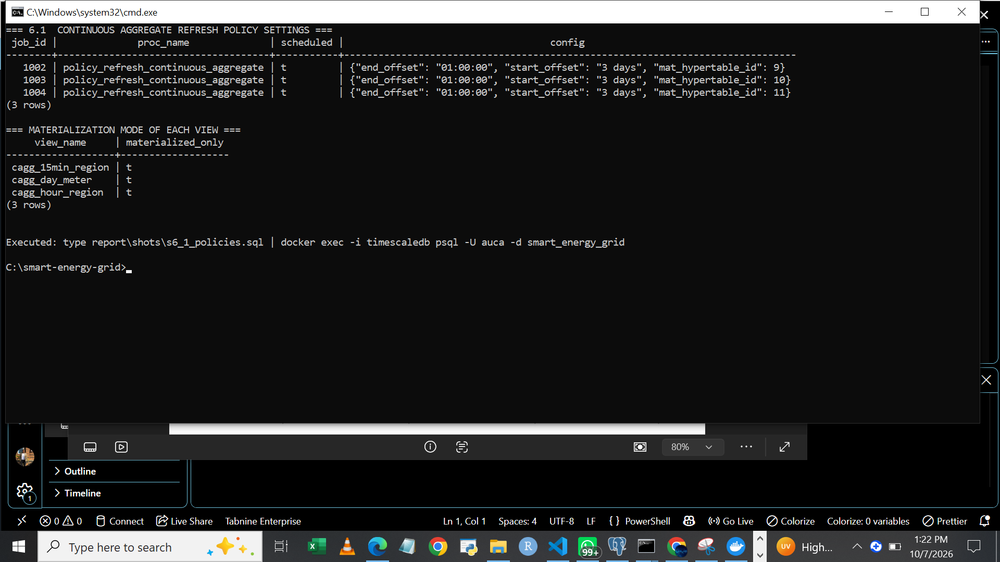

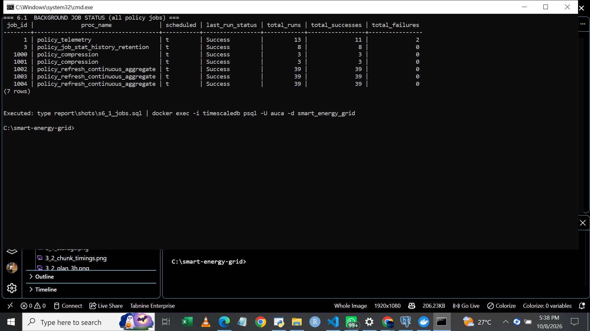

| View | Bucket | Stored | Initial refresh |
|---|---|---|---|
| `cagg_15min_region` | 15 min × region | 4.156 MB | 51.672 s |
| `cagg_hour_region` | 1 h × region | 1.234 MB | 31.222 s |
| `cagg_day_meter` | 1 d × meter | 12.539 MB | 16.150 s |

All three are `materialized_only = true`. Total stored: **17.929 MB** (about 1.3%
of the 1351 MB uncompressed baseline). Refresh policy: `start_offset` 3 days,
`end_offset` 1 hour, schedule every 15 minutes; job ids 1002–1004 (compression jobs
are 1000/1001), all `scheduled = true`.

**Explanation.** Storage is tiny against the baseline because the views hold
15-minute → daily grain only. The initial refresh costs fall as the bucket gets
wider (51.672 s for 15-minute buckets over the whole period vs 16.150 s for
daily), because there are 26,880 fifteen-minute region buckets but only 112,000
daily meter buckets evaluated at a much coarser granularity. The `end_offset` of
1 hour exists so the policy never tries to materialise the hour still being
written.

## 6.2 Freshness and delayed arrivals

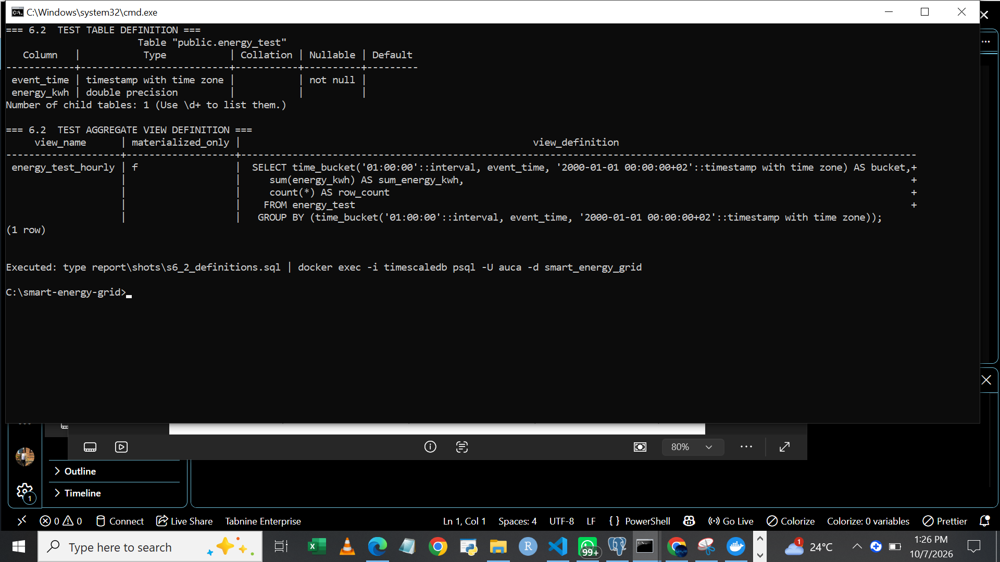

| Stage | Result |
|---|---|
| A. insert 1.0 kWh in the older hour, refresh only that hour | older hour shows energy = 1 kWh, rows = 1 |
| B. insert 0.5 kWh (old) and 2.0 kWh (hour H), no refresh, `materialized_only = TRUE` | old hour still 1 kWh; hour H absent |
| C. enable real-time aggregation, still no refresh | old hour still 1 kWh; **hour H appears with 2 kWh** |
| D. refresh both complete hours | old hour = **1.5 kWh, rows 2**; hour H = 2 kWh, rows 1 |

Policy at test time (2026-10-07 01:22:45, H = 00:00 CAT): it may refresh buckets
ending at or before 2026-10-07 00:22:45 +02, so the older hour **YES** and hour H
**no**.

**Explanation.** The four stages separate three things people conflate.
`materialized_only = TRUE` hides unrefreshed rows completely (stage B); real-time
aggregation surfaces them for buckets no policy has touched yet (stage C); and an
explicit refresh is what merges a late arrival into an already-materialised bucket
(stage D, 1 → 1.5 kWh). The policy cutoff is what makes September data
recoverable: refreshes are bounded by `end_offset` relative to the **database**
clock, so inserting a row in September today needs a manual
`refresh_continuous_aggregate` over that range. That is the operational caveat for
delayed arrivals.

# Section 7 — Dashboards

Two Dash (Plotly) dashboards expose the same five panels and filters; only the
data source differs. `Raw` reads `energy_readings`; `Aggregate` reads the
continuous aggregates. This is a deliberate, explained deviation from the
Grafana-based brief, which is documented in `docs/section7_summary.md`:
Grafana is not installed on this machine, so its API, `/api/ds/query` panel
timings and query-caching steps are replaced by the dashboards' own per-panel
timings and a Playwright-driven Chrome benchmark.

| Panel | Title | Unit | Raw source | Aggregate source |
|---|---|---|---|---|
| P1 | Hourly regional energy | kWh | `energy_readings JOIN meters` | `cagg_hour_region` |
| P2 | Daily network energy | kWh | `energy_readings` | `cagg_15min_region` re-bucketed to CAT days |
| P3 | Seven-day period energy | kWh | `energy_readings` | `cagg_15min_region` re-bucketed |
| P4 | Daily energy of selected meter | kWh | `energy_readings` (meter filter) | `cagg_day_meter` |
| P5 | Completeness by region | percent | `energy_readings JOIN meters` | `cagg_15min_region` + `meters` |

Default range `[2026-09-22 .. 2026-09-29)` exclusive, all regions, meter
`1000000000`. Panel SQL lives in `sql/dashboards/{raw,aggregate}/`; portable
definitions are exported to `dashboards/Raw.json` and `Aggregate.json`.

*Panel query definitions: `report/screenshots/7_2_panel_defs.csv` (and `sql/dashboards/raw/*.sql`, `sql/dashboards/aggregate/*.sql`).*

## 7.1 Raw dashboard

Missing screenshot — Section 7.1 (running Raw dashboard at http://127.0.0.1:8050 with all five panels, taskbar and clock visible). Insert the recorded dashboard image here.

## 7.2 Aggregate dashboard

Missing screenshot — Section 7.2 (running Aggregate dashboard at http://127.0.0.1:8051 with all five panels, taskbar and clock visible). Insert the recorded dashboard image here.

## 7.3 Matching results

Both dashboards must return the same numbers. Range `[2026-09-22 .. 2026-09-29)`
exclusive, all regions, meter `1000000000`:

| Panel | Rows (Raw = Agg) | Keys identical | Counts identical | Max abs energy diff (kWh) | Status |
|---|---|---|---|---|---|
| P1 | 1680 | yes | yes | 0.000000 | PASS |
| P2 | 7 | yes | yes | 0.000000005 | PASS |
| P3 | 1 | yes | yes | 0.000000004 | PASS |
| P4 | 7 | yes | yes | 0.000000 | PASS |
| P5 | 10 | yes | n/a | n/a | PASS |

**PASS — both dashboards match within tolerance** (all energy differences
≤ 0.001 kWh before rounding; differences on P2/P3 are at the 1e-09 float
summation level).

## 7.4 Performance

Warm cache, 1 warm-up + 10 measured refreshes per mode, Raw then Aggregate,
background jobs 1000–1004 paused, driven through Google Chrome 154 via Playwright
1.63. Per-panel = dashboard query duration; dashboard = click-to-render of all
five panels.

| Mode | P1 | P2 | P3 | P4 | P5 | Dashboard |
|---|---|---|---|---|---|---|
| Raw median (ms) | 1229.568 | 738.258 | 880.359 | 9.401 | 1282.902 | **5699.258** |
| Aggregate median (ms) | 42.591 | 13.945 | 9.932 | 7.138 | 13.686 | **1272.613** |
| Speed-up | 28.9× | 52.9× | 88.6× | 1.3× | 93.7× | **4.5×** |
| Improvement | 96.5% | 98.1% | 98.9% | 24.1% | 98.9% | **77.7%** |

**Judgement.** The Aggregate dashboard returns the same five panels with the same
keys and counts and reduces the whole-dashboard refresh from a median of
**5699.258 ms to 1272.613 ms (4.5×, 77.7% faster)**. The price is **17.961 MB**
stored aggregates (about 1.3% of the baseline) plus a one-off **99.044 s** initial
refresh, after which the 15-minute policy keeps them current. The gain is real but
not free: the whole-dashboard figure (4.5×) is smaller than the per-panel SQL gains
(up to 94×) because the browser must still render five Plotly panels, and P4 (a
single-meter point lookup already served by an index) gains only 24% — continuous
aggregates are not a universal accelerator.

# Section 8 — Forecast the next day

## 8.1 Dataset

Source `cagg_hour_region`: 6,720 raw rows, 10 regions, 6,720 expected region-hour
rows, **0 absent hour rows**. Split by target timestamp, never randomly:

| Split | First hour | Last hour | Rows |
|---|---|---|---|
| train | 2026-09-01 00:00 +02 | 2026-09-14 23:00 +02 | 3,360 |
| validation | 2026-09-15 00:00 +02 | 2026-09-21 23:00 +02 | 1,680 |
| test | 2026-09-22 00:00 +02 | 2026-09-28 23:00 +02 | 1,680 |

Features: `lag1d` (24 h), `lag2d` (48 h), `prev_day_mean` (24 h window), `hour`,
`day_of_week`, `is_weekend`, `day_index`, `region` (one-hot). After dropping rows
before the 48-hour lookback, **2,880 usable training rows** remain (0 missing lag
values).

## 8.2 Baseline

Previous-day baseline on 1,680 test observations: MAE **42.708281 kWh**, RMSE
**79.402867 kWh**.

## 8.3 Model selection and training

*Dataset/training evidence: `report/screenshots/8_1_dataset.txt`, `8_2_baseline.txt`, `8_3_model.txt`.*

Two gradient-boosting configurations were trained and compared on the validation
split:

| Config | Train rows | Val rows | Val MAE | Val RMSE |
|---|---|---|---|---|
| GB-1 | 2,880 | 1,680 | **15.090665** | 20.186161 |
| GB-2 | 2,880 | 1,680 | 17.743412 | 24.608861 |

**GB-1** was selected (lowest validation MAE; config frozen in
`forecasting/selected_model_config.json`). Frozen test result: **test MAE
15.116640 kWh, test RMSE 20.802111 kWh** over 1,680 predictions.

## 8.4 Comparison and usefulness

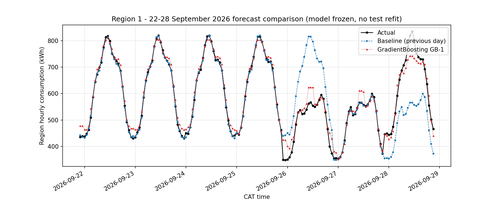

| Method | MAE | RMSE |
|---|---|---|
| baseline | 42.708281 | 79.402867 |
| model | **15.116640** | **20.802111** |

**Model MAE improvement over baseline: 64.60%.** Every one of the ten regions
improves individually; the best is Region 4 (34.856 → 11.456 kWh) and the weakest
is Region 8 (55.967 → 20.227 kWh). Example, Region 1 on its busiest hour
(2026-09-28 13:00 CAT, actual 835.609 kWh): baseline error 270.339 kWh, model
error 93.047 kWh.

**Usefulness judgement.** The model is 2.83× better than the baseline on MAE and
3.82× better on RMSE, and it cuts the peak-hour error from 270.339 to 93.047 kWh
on the busiest hour of the month — the error that matters for planning is the peak
error, not the mean. The improvement is real but not unconditional: the model is
driven by lag features, so it inherits any missing or delayed reading in the
previous day, and the freshness test shows the current hour can be absent from a
`materialized_only` view until a refresh runs. A live forecast should therefore
read its lags from the raw table (or from a view with real-time aggregation
enabled), not from a not-yet-refreshed bucket.

# Section 9 — Report organisation, repository and contributions

## 9.1 Report organisation

This report follows the required subsection order. Each subsection shows the
executed action or result, a measurement table, the relevant screenshots (with the
taskbar and clock visible), and a separate explanation of *why* the numbers came
out as they did. Observations and explanations are kept apart on purpose, because
Sections 3.3 and 4.4 are graded partly on that distinction. All timing figures are
medians of repeated runs on a 2-physical-core / 7.85 GB machine whose limits are
stated in Section 1.1.2.

## 9.2 Repository and ZIP

`<GITHUB_URL_PLACEHOLDER>` — the repository and ZIP `<ZIP_NAME_PLACEHOLDER>`
contain:

- the **unchanged** supplied generator `smart_meter_simulator.py`;
- capture and ingestion programs (`ingestion/`), the MQTT pilot
  (`ingestion/pilot_publish.py`, `ingestion/pilot_subscribe.py`) and the cleaning
  programs (`cleaning/`);
- the SQL for every section (`sql/00_create_database.sql` … `sql/` aggregates and
  `sql/dashboards/{raw,aggregate}/p1..p5*.sql`);
- analysis and model code (`analysis/`, `forecasting/`), including the frozen
  model config `forecasting/selected_model_config.json`;
- recorded benchmark timings (`benchmarks/*.csv`, `results/dashboard_timings_*.csv`);
- the validation comparison (`results/dashboard_match.csv`);
- dashboard queries and portable config (`dashboards/Raw.json`,
  `dashboards/Aggregate.json`);
- environment details (`report/environment_details.md`) and this report;
- `README.md` with the execution order.

Secrets are placeholdered: the repository ships `config.example.py` with
placeholders only; `config.py` is git-ignored and never committed. The full
dataset and intermediate CSVs stay out of Git and are regenerated from the
unchanged generator.

## 9.3 Contribution split

| Member | Student ID | Contribution |
|---|---|---|
| Umwali Samantha | 101401 | **Sections 1–3.** Environment capture and database creation; schema and hypertable; meter loader; MQTT pilot (publish/subscribe, four counts); full capture and load of the 10.7M-row stream; data-quality investigation, the required percentages and arithmetic checks; deduplication and the frozen benchmark; the chunk-interval comparison (layout, storage, timings, plan analysis). |
| Serugo Eric | 101384 | **Sections 4, 6, 7.** Compression experiment (both layouts, storage ratios, compressed timings, selection); continuous aggregates (definitions, storage, refresh policies, freshness/delayed-arrival test); dashboards (Raw vs Aggregate panels, matching results, browser timing benchmark, Grafana-deviation note). |
| Uwamariya Josepine | 101386 | **Sections 5, 8, 9.** Utility-data investigation (demand patterns, regions and customer types, reporting quality, anomaly detection); the management recommendation; forecast dataset, baseline, model training and selection, comparison and usefulness judgement; report organisation and repository/contribution write-up. |

All three members reviewed the final report and the run evidence.

# Appendix — evidence files

| Section | Evidence |
|---|---|
| 1 | `logs/environment_capture_2026-10-06_23-53-33.txt`, `report/environment_details.md`; pilot `logs/pilot_subscribe_latest.txt`, `logs/pilot_counts.json` |
| 2 | `logs/readings_load_2026-10-06_16-03-13.txt`; `logs/data_quality_*_PRECLEAN.txt`, `logs/restore_duplicates_*.txt`, `logs/clean_readings_*.txt` |
| 3 | `logs/chunk_verify_*.txt`, `logs/chunk_benchmark_*.txt`, `benchmarks/chunk_timings.csv`, `logs/explain_chunk_configs.txt` |
| 4 | `logs/compressed_load_*.txt`, `logs/compression_storage_*.txt`, `logs/compressed_benchmark_*.txt`, `benchmarks/compressed_timings.csv`, `logs/explain_compressed.txt` |
| 5 | `logs/demand_patterns_*.txt`, `logs/regions_*.txt`, `logs/reporting_quality_*.txt`, `logs/anomalies_*.txt` |
| 6 | `logs/dashboard_benchmark_2026-10-07_01-31-51.txt`, `logs/cagg_freshness_2026-10-07_01-22-45.txt` |
| 7 | `docs/section7_summary.md`, `results/dashboard_match.csv`, `results/dashboard_timings_summary.csv`, `results/cagg_storage_and_refresh.csv` |
| 8 | `logs/forecast_dataset_*.txt`, `logs/baseline_*.txt`, `logs/model_training_*.txt`, `logs/forecast_comparison_*.txt`, `forecasting/selected_model_config.json` |
